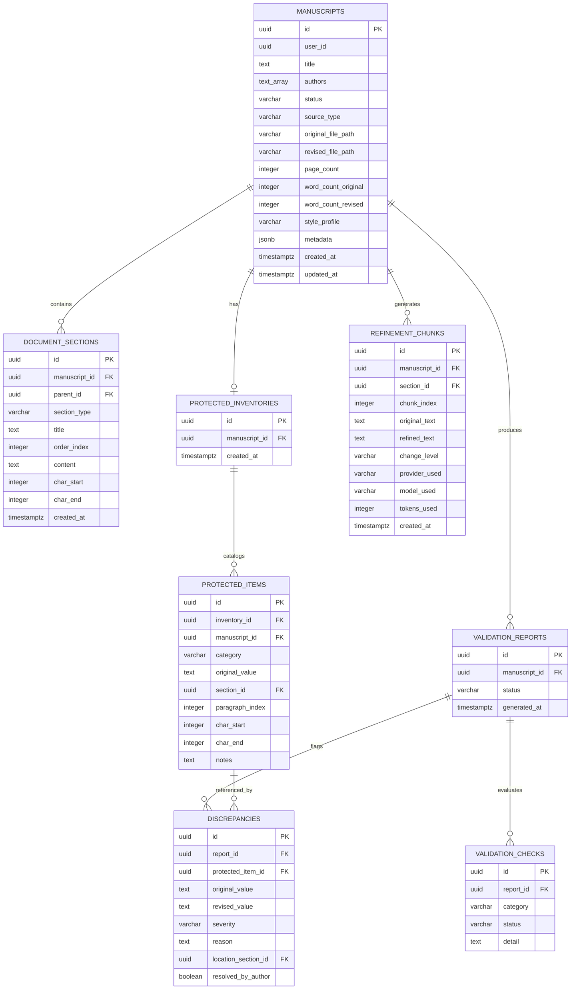

# Database Schema Specification — Scientific Humanizer

---

## 1. Overview & Relational Design

The Scientific Humanizer database schema is engineered for PostgreSQL (native Supabase support) with strict relational integrity, foreign key cascading, and Row-Level Security (RLS). The design cleanly models the manuscript intake, immutable protected inventory, chunk-level refinement artifacts, and validation reports.

---

## 2. Entity Relationship Diagram (ERD)

---

## 3. Data Dictionary

### 3.1 `manuscripts` Table
Core record tracking manuscript ingestion, processing lifecycle, and file locations.
- `id` (UUID, Primary Key): Unique manuscript identifier.
- `user_id` (UUID, Nullable): Author/owner identifier for multi-tenant access control.
- `title` (TEXT): Title extracted from manuscript metadata or provided by user.
- `authors` (TEXT[]): Array of author names extracted from manuscript.
- `status` (VARCHAR(32)): Current lifecycle stage (`uploaded`, `parsed`, `inventory_extracted`, `profiled`, `refining`, `refined`, `validated`, `completed`, `failed`).
- `source_type` (VARCHAR(16)): Ingestion channel (`docx`, `pdf`, `url`, `text`).
- `original_file_path` (TEXT): Encrypted storage reference for original uploaded manuscript.
- `revised_file_path` (TEXT): Encrypted storage reference for compiled revised DOCX.
- `page_count` (INTEGER): Calculated manuscript page count.
- `word_count_original` (INTEGER): Word count of source manuscript.
- `word_count_revised` (INTEGER, Nullable): Word count of refined manuscript.
- `style_profile` (VARCHAR(32)): Selected academic genre profile (`original_research`, etc.).
- `metadata` (JSONB): Parsed document metadata (DOI, journal, OCR flags, extraction timestamp).
- `created_at` (TIMESTAMPTZ): Ingestion timestamp.
- `updated_at` (TIMESTAMPTZ): Last activity timestamp.

### 3.2 `document_sections` Table
Decomposed section nodes capturing hierarchical structure.
- `id` (UUID, Primary Key): Section identifier.
- `manuscript_id` (UUID, Foreign Key -> `manuscripts.id` ON DELETE CASCADE).
- `parent_id` (UUID, Foreign Key -> `document_sections.id`, Nullable): Hierarchical parent section.
- `section_type` (VARCHAR(32)): Classified section taxonomy (`introduction`, `methods`, `results`, `discussion`, etc.).
- `title` (TEXT): Section heading text.
- `order_index` (INTEGER): Sequence order within document.
- `content` (TEXT): Text content of section.
- `char_start` / `char_end` (INTEGER): Character coordinate bounds within raw document.

### 3.3 `protected_inventories` & `protected_items` Tables
Immutable pre-refinement baseline of protected scientific items.
- `inventory_id` (UUID, Foreign Key -> `protected_inventories.id` ON DELETE CASCADE).
- `category` (VARCHAR(32)): One of the 15 protected categories (`statistical_result`, `drug_dosage`, `numerical_data`, etc.).
- `original_value` (TEXT): Exact verbatim text or numerical expression extracted.
- `location`: Paragraph and character coordinates.
- `notes` (TEXT, Nullable): Contextual classification notes.

### 3.4 `validation_reports` & `discrepancies` Tables
Audit reports verifying revised text against the protected inventory.
- `report_id` (UUID, Primary Key).
- `status` (VARCHAR(16)): `PASS`, `WARNING`, or `FAIL`.
- `severity` (VARCHAR(16)): Discrepancy severity classification (`INFO`, `WARNING`, `FAIL`).
- `reason` (TEXT): Mechanistic explanation of detected divergence.
- `resolved_by_author` (BOOLEAN): Explicit author review flag (defaults to `false`).

---

## 4. Privacy, Retention & Deletion Architecture

1. **Configurable Retention Windows:** Managed by `SH_STORAGE_RETENTION_DAYS` (default: 30 days). A daily scheduled routine automatically purges records and file blobs older than the retention threshold.
2. **Author-Controlled Hard Purge:** When a user initiates document deletion, an atomic database cascade deletes all associated records from `manuscripts`, `document_sections`, `protected_inventories`, `protected_items`, `refinement_chunks`, and `validation_reports`, followed by immediate unlinking of physical storage blobs.
3. **Audit Trail Anonymization:** System logs store operation status, timestamps, and token volumes only. Manuscript content and author text are strictly excluded from logging tables.
